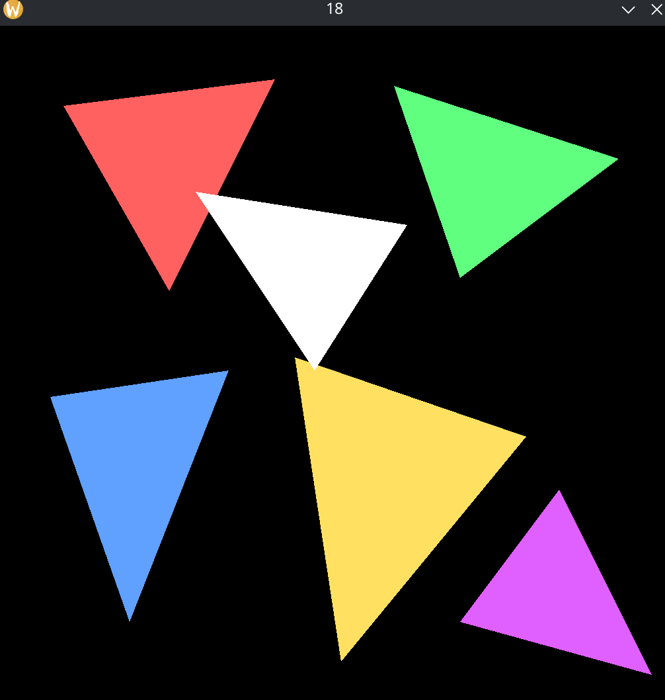

# Rasterizer

A small software rasterizer written in C++ with SDL2. All drawing happens on a CPU-side pixel buffer, which is uploaded to a streaming texture and presented each frame. No GPU drawing is involved.

## Features

- Pixel plotting into a 1024×1024 ARGB8888 framebuffer
- Line drawing
- Triangle outlines
- Filled triangles (using signed area)

### Line Drawing

Line drawing is based on Bresenham's line algorithm, using
slope and rounding second axis.

### Filled Triangles

Filled triangles uses bounding box and barycentric coords
to fill triangle; could be done in parrelel but not done
here since everything is cpu sided.



## Requirements

- A C++ compiler (g++ or clang++)
- SDL2 development libraries
  - Fedora: `sudo dnf install SDL2-devel`
  - Debian/Ubuntu: `sudo apt install libsdl2-dev`
  - macOS: `brew install sdl2`

## Build & Run

```bash
g++ SDLblit.cpp -o blit $(sdl2-config --cflags --libs)
./blit
```

## Credits

The SDL blit scaffold is based on [SDLblit.cpp by Cory Bloyd](https://gist.github.com/CoryBloyd/6725bb78323bb1157ff8d4175d42d789#file-sdlblit-cpp) (CC0).
